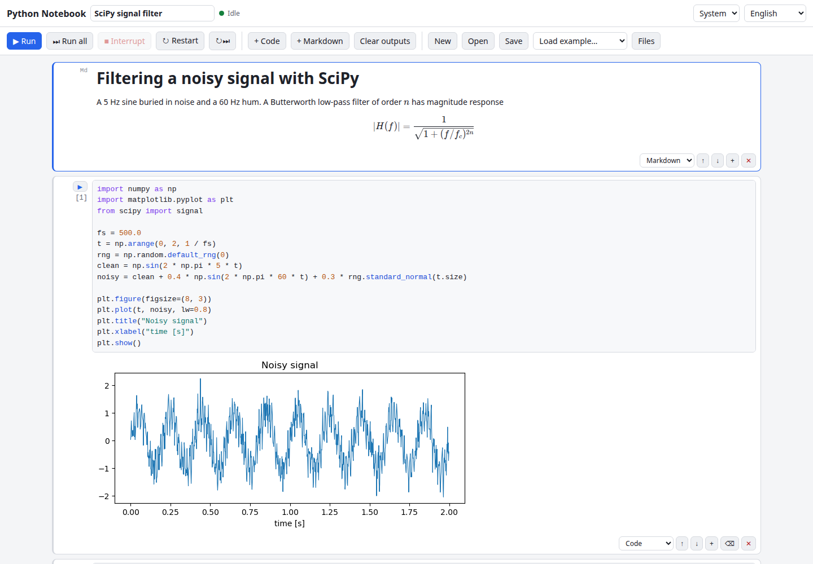

# Browser Python Notebook

A Jupyter-style notebook that runs Python entirely in your browser. Code cells execute on [Pyodide](https://pyodide.org) (CPython compiled to WebAssembly) inside a Web Worker, with NumPy, SciPy, Matplotlib and pandas loaded on demand. There is no server: your code, data and notebooks never leave the page.

**Try it: [hermes98761234.github.io/browser-python-notebook](https://hermes98761234.github.io/browser-python-notebook/)**

[](https://github.com/hermes98761234/browser-python-notebook/actions/workflows/deploy.yml)



## Features

- **Code and Markdown cells.** CodeMirror 6 editor with Python highlighting. Markdown is rendered with [marked](https://marked.js.org) and KaTeX math (`$x^2$`, `$$...$$`).
- **Run like Jupyter.** Shift+Enter runs and moves on, Ctrl+Enter runs in place, Alt+Enter runs and inserts a cell. Run all, restart kernel, execution counters (`[3]`, `[*]` while running), top-level `await`.
- **Live output.** stdout and stderr stream while the cell runs. Matplotlib figures appear as PNG (on `plt.show()` and at the end of the cell), pandas DataFrames as HTML tables, everything else as `repr`. Tracebacks show the failing line.
- **Packages on demand.** Imports of NumPy, SciPy, pandas, Matplotlib and the rest of the Pyodide distribution are detected and loaded automatically. `%pip install name` installs pure-Python wheels from PyPI through micropip.
- **Interrupt.** Pages cannot send the COOP/COEP headers that `SharedArrayBuffer` interrupts need, so Interrupt stops the kernel by restarting it. The running cell gets a `KeyboardInterrupt` and variables are lost.
- **Files.** Upload files into the Pyodide file system (`/home/pyodide`), read them from Python, and download anything your code writes, such as `df.to_csv("out.csv")`.
- **Jupyter compatible.** Open and save `.ipynb` (nbformat 4, with outputs). Notebooks open in JupyterLab and VS Code, and Jupyter notebooks open here.
- **Autosave** to IndexedDB (localStorage fallback), so a reload brings your notebook back.
- **Examples.** Welcome, NumPy basics, SciPy signal filter, curve fit, pandas CSV analysis. A link such as `#example=pandas` opens one directly.
- **English or Ukrainian, light, dark or system theme**, responsive layout, settings kept in the browser.

## How it works

The page is a React app. A notebook is plain data (`src/lib/model.ts`) changed by pure functions: add, move and delete cells, merge streamed output, number executions. `src/lib/ipynb.ts` converts it to and from nbformat 4 JSON.

Python runs in `src/kernel/pyodide.worker.ts`. The worker loads the Pyodide runtime from the jsDelivr CDN (the version pinned by the `pyodide` npm package, which is only used for types) and runs a small Python bootstrap (`src/kernel/bootstrap.py`). For each cell the worker calls `loadPackagesFromImports`, then `eval_code_async` for last-expression values and top-level `await`. Matplotlib uses the Agg backend and figures are sent as base64 PNG. Objects with `_repr_html_` are shown as HTML. Output HTML from notebooks is sanitized before it is inserted.

**The Pyodide runtime (about 10 MB) and its packages are fetched from the jsDelivr CDN** on first use, so the first run needs an internet connection. The app itself is a static site with no backend.

## Quick start

You need [Node.js](https://nodejs.org/) 22.

```bash
git clone https://github.com/hermes98761234/browser-python-notebook.git
cd browser-python-notebook
npm install
npm run dev       # http://localhost:5173
npm test          # notebook model, ipynb, Markdown and i18n tests
npm run build     # static site in dist/
```

## License

MIT
